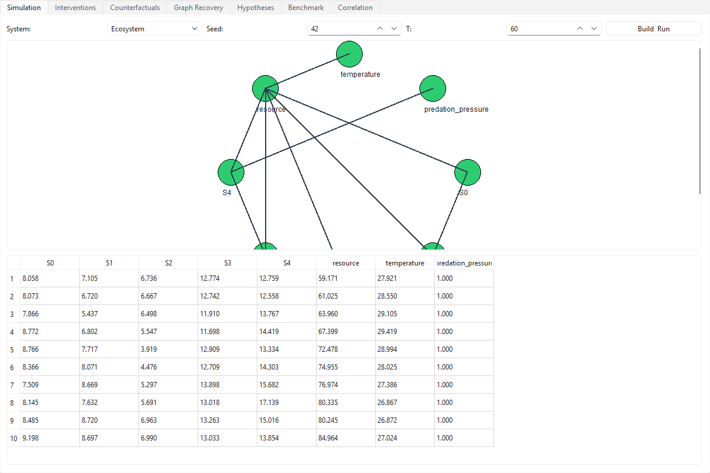
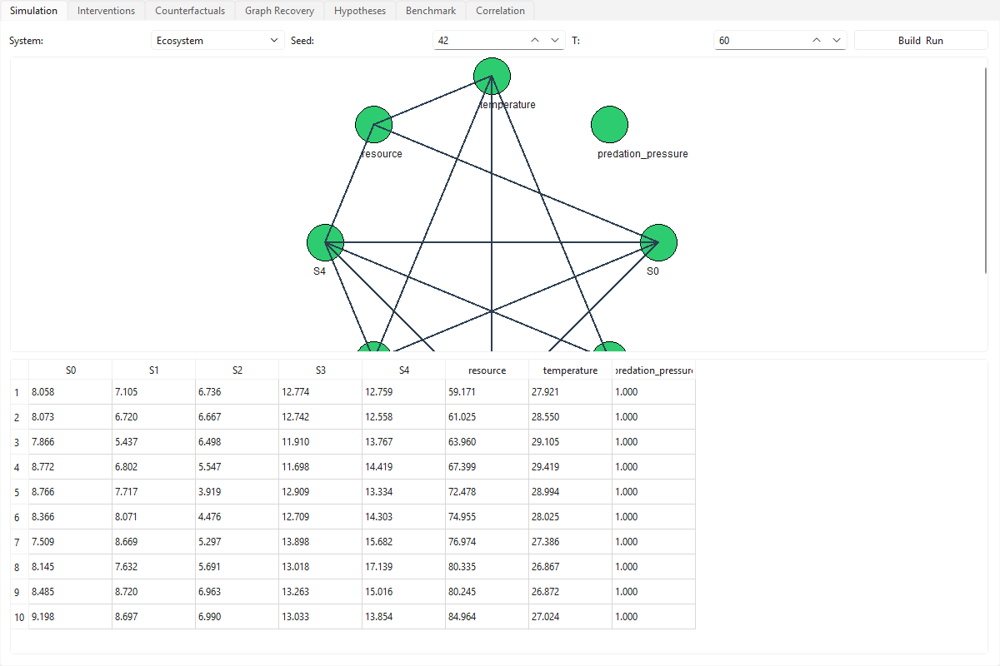

# CAUSALITY ENGINE

[](LICENSE)
[](https://www.python.org/)
[](https://doc.qt.io/qtforpython/)

Computational research environment investigating whether AI can distinguish causal mechanisms from correlations. Never equates correlation with causation.

## Visual Showcase





## Overview

Causality Engine builds configurable synthetic ecosystems, population dynamics, resource systems, physical models, and artificial economies with **known ground-truth causal structures**. It provides structural causal models, interventions (do-operator), counterfactual analysis, hidden variables, time-series analysis, alternative hypotheses, and automated experiment selection. It benchmarks graph recovery, false discovery rate, intervention prediction, noise robustness, and generalization, with negative controls and reproducible experiments.

## Key Features

- Configurable ecosystems with known ground-truth DAGs
- Structural causal models (SCM) with interventions and counterfactuals
- Hidden/latent confounders
- Time-series causal analysis
- Alternative hypothesis comparison
- Automated experiment selection (active learning)
- Graph recovery: PC skeleton, hill-climbing
- Metrics: SHD, FDR, TPR, noise robustness, generalization
- Negative controls
- Interactive PySide6 desktop app
- Reproducible seeded experiments

## Installation

### Executable (Windows)
Download `CausalityEngine-win64.zip` from the [Releases page](https://github.com/Nortaq-PlayNexus/causality-engine/releases), extract, run `CausalityEngine.exe`.

### From source
```
git clone https://github.com/Nortaq-PlayNexus/causality-engine.git
cd causality-engine
pip install PySide6
python main.py
```

## Quick Start
1. Launch app
2. Select a system (e.g., Ecosystem), set seed, click "Build & Run"
3. View ground-truth causal graph
4. Run PC skeleton / Hill-Climbing in Graph Recovery tab to compare

## Usage
- Simulation tab: build and run synthetic systems
- Interventions tab: apply do(X=x)
- Counterfactuals tab: compute counterfactual outcomes
- Graph Recovery tab: recover graph, view SHD/FDR/TPR
- Hypotheses tab: compare alternative causal graphs
- Benchmark tab: run full benchmark suite
- Correlation tab: correlation matrix with causation caveat

## Architecture
```
causality_engine/
  core/        # causal graph, SCM, ecosystems, recovery, metrics, etc.
  benchmark/   # benchmark suite
  ui/          # PySide6 application
main.py        # entry point
tests/         # pytest
```

## Technology Stack
Python 3.12, PySide6, SQLite, pure-Python (no numpy/scipy).

## Testing
```
pytest tests/ -q
```
Result: 5 passed.

## Building
```
python -m PyInstaller --noconfirm --windowed --name CausalityEngine --add-data "causality_engine;causality_engine" main.py
```

## Troubleshooting
- If app fails to start, ensure PySide6 installed.
- Offscreen: set QT_QPA_PLATFORM=offscreen.

## Research Methodology
Ground-truth DAGs are defined by construction in each synthetic domain. Recovery algorithms are evaluated against ground truth using SHD/FDR/TPR. Negative controls use independent random variables (expect no edges). Reproducibility via seeds. Correlation is never treated as causation.

## Limitations
- Recovery algorithms are simplified (no full PC/FCI).
- Counterfactuals are approximate.
- No real-world datasets included.

## Contributing
Pull requests welcome.

## Security
Report issues via GitHub issues.

## License
MIT — see LICENSE.

## Citation
```
@software{causality_engine_2026,
  title={Causality Engine},
  author={Nortaq-PlayNexus},
  year={2026},
  url={https://github.com/Nortaq-PlayNexus/causality-engine}
}
```
